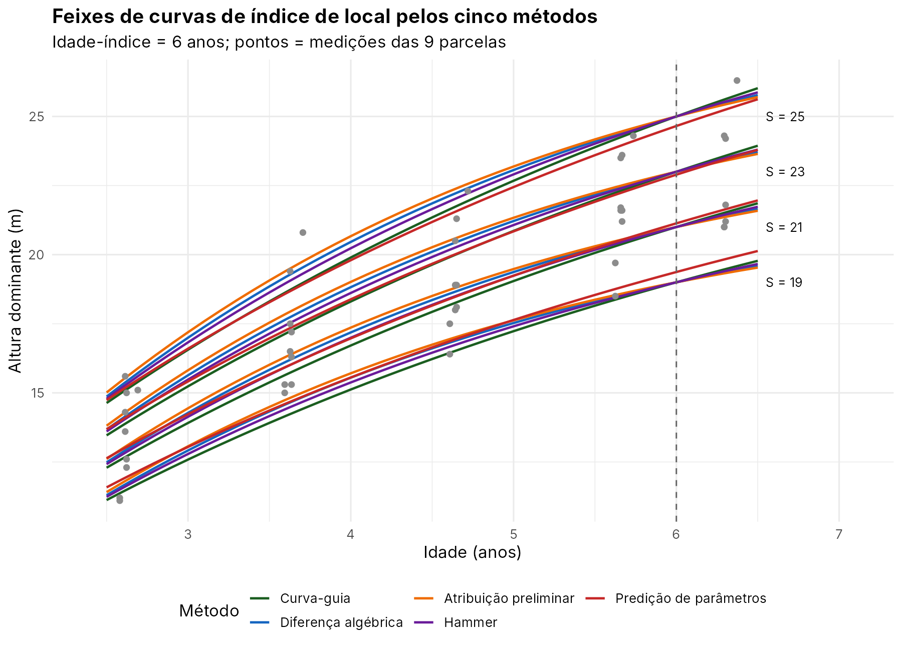
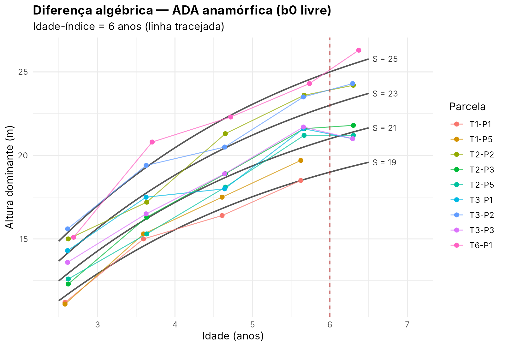

<div align="center">

# 🌲 Desafio 07 — Classificação de sítios florestais

**Curvas de índice de local por cinco métodos**

   

*Disciplina Mensuração Florestal · Programa de Pós-Graduação em Ciências Florestais · ICA/UFMG*

</div>

## 📋 Objetivo

Construir curvas de índice de local para 9 parcelas permanentes de eucalipto pelos cinco métodos de classificação da capacidade produtiva: curva-guia, diferença algébrica, atribuição preliminar de índices de local, método de Hammer e predição de parâmetros, e comparar os resultados.

## 🗂️ Dados

| Variável | Valor |
|---|---|
| Projeto | C531 (talhões 1, 2, 3 e 6) |
| Parcelas permanentes | 9, com 4 a 5 medições cada (43 no total) |
| Idade | 2,6 a 6,4 anos |
| Altura dominante | 11,1 a 26,3 m |

Arquivo: [`dados/Sitio.xls`](dados/Sitio.xls).

## 🔧 Métodos

**Definições comuns aos cinco scripts** ([`scripts/00_config.R`](scripts/00_config.R)):

| Definição | Valor | Por quê |
|---|---|---|
| Modelo de base | Chapman-Richards: Hd = b₀ · (1 − e<sup>−b₁·I</sup>)<sup>b₂</sup> | Biológico (assíntota e inflexão); o mesmo nas partes 1, 2, 3 e 5 |
| Idade-índice | **6 anos** | Dentro dos dados e próxima da idade de corte |
| Classes de S | **19, 21, 23 e 25 m** | Cobrem a amplitude de S das 9 parcelas |
| Classificação | Medição mais próxima de 6 anos | Menor extrapolação |

| Método | Script | Modelo selecionado |
|---|---|---|
| Curva-guia | [`01_curva_guia.R`](scripts/01_curva_guia.R) | Chapman-Richards (testados também Schumacher e logístico) |
| Diferença algébrica | [`02_diferenca_algebrica.R`](scripts/02_diferenca_algebrica.R) | Formulação anamórfica, ajustada a 34 pares consecutivos |
| Atribuição preliminar | [`03_atribuicao_preliminar.R`](scripts/03_atribuicao_preliminar.R) | Modelo anamórfico com S como covariável |
| Hammer | [`04_hammer.R`](scripts/04_hammer.R) | Assíntota por classe de produtividade, forma comum |
| Predição de parâmetros | [`05_predicao_parametros.R`](scripts/05_predicao_parametros.R) | b₀ = 3,97 + 1,321·S, com b₁ fixo e b₂ constante |

## 📈 Principais resultados

- **Os cinco métodos classificaram as 9 parcelas na mesma classe**, com no máximo 0,5 m de diferença de S entre métodos.
- Todos os métodos indicaram curvas **anamórficas**: os testes de polimorfismo não foram sustentados pelos dados.
- A **diferença algébrica anamórfica** teve o menor erro de projeção a partir da idade-índice (0,84 m, contra 1,63 m da formulação polimórfica) e é o método recomendado.

| Classe de S | Parcelas |
|:-:|---|
| 19 m | T1-P1 |
| 21 m | T1-P5, T2-P3, T2-P5, T3-P1, T3-P3 |
| 23 m | T2-P2, T3-P2 |
| 25 m | T6-P1 |

<p align="center">
  <br>
  <sub><b>Feixes de curvas de índice de local pelos cinco métodos</b></sub>
</p>

<p align="center">
  <br>
  <sub><b>Método recomendado: diferença algébrica anamórfica</b></sub>
</p>

## 📁 Estrutura do repositório

```text
desafio-07-classificacao-sitio/
├── dados/
│   └── Sitio.xls
├── scripts/
│   ├── 00_config.R                  # idade-índice, classes de S, funções comuns
│   ├── 01_curva_guia.R
│   ├── 02_diferenca_algebrica.R
│   ├── 03_atribuicao_preliminar.R   # usa a saída do script 01
│   ├── 04_hammer.R
│   ├── 05_predicao_parametros.R
│   └── 06_comparacao.R              # consolida os cinco métodos
├── resultados/                      # uma pasta por método
│   ├── 01_curva_guia/
│   ├── 02_diferenca_algebrica/
│   ├── 03_atribuicao_preliminar/
│   ├── 04_hammer/
│   ├── 05_predicao_parametros/
│   └── 06_comparacao/
└── docs/
    ├── enunciado.pdf
    └── relatorio.md
```

## ▶️ Como executar

A partir da raiz do repositório:

```r
install.packages(c("readxl", "ggplot2"))
```

```bash
for s in 01_curva_guia 02_diferenca_algebrica 03_atribuicao_preliminar 04_hammer 05_predicao_parametros 06_comparacao; do
  Rscript scripts/$s.R
done
```

Cada pasta de `resultados/` contém as curvas (`curvas_*.csv`), a classificação das parcelas (`indice_local_parcelas_*.csv`), as métricas de ajuste, o feixe de curvas e os resíduos.

## 📄 Documentos

- 📝 [Enunciado](docs/enunciado.pdf)
- 📊 [Relatório com a avaliação dos cinco métodos](docs/relatorio.md)

## 🧭 Série de desafios

| # | Desafio | |
|:-:|---|:-:|
| 01 | [Diâmetro](https://github.com/danieldias936-cyber/desafio-diametro-eucalipto) | |
| 02 | [Altura e relação hipsométrica](https://github.com/danieldias936-cyber/desafio_altura) | |
| 03 | [Volume e forma](https://github.com/danieldias936-cyber/desafio_volume-e-forma) | |
| 04 | [Volume reduzido e equações de volume](https://github.com/danieldias936-cyber/desafio-04-volume-reduzido-e-tabela) | |
| 05 | [Taper e sortimento](https://github.com/danieldias936-cyber/desafio_taper_e_sortimento) | |
| 06 | [Amostragem de Bitterlich](https://github.com/danieldias936-cyber/desafio-06-bitterlich) | |
| **07** | **Classificação de sítios florestais** | 📍 você está aqui |
| 08 | [Validação do índice de sítio](https://github.com/danieldias936-cyber/desafio-08) | |
| 09 | [Crescimento e produção (Clutter)](https://github.com/danieldias936-cyber/desafio-09) | |

## 👤 Autor

**Daniel Dias** · [@danieldias936-cyber](https://github.com/danieldias936-cyber)  
Mestrado em Ciências Florestais — ICA/UFMG, Montes Claros (MG)
