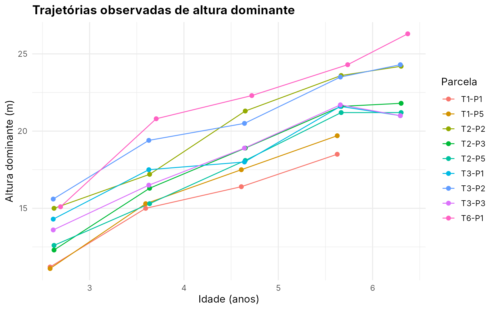
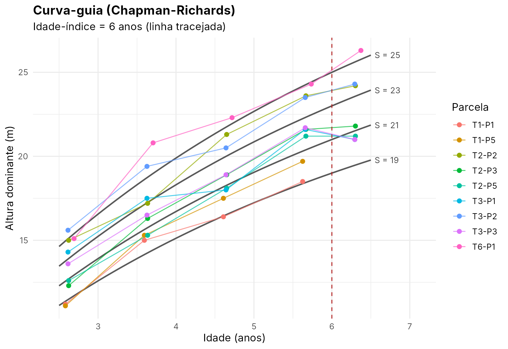
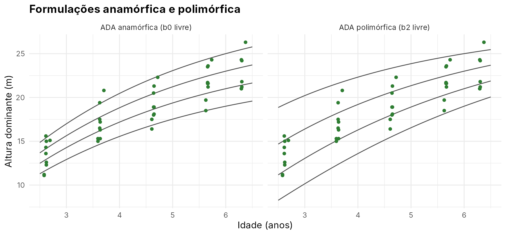
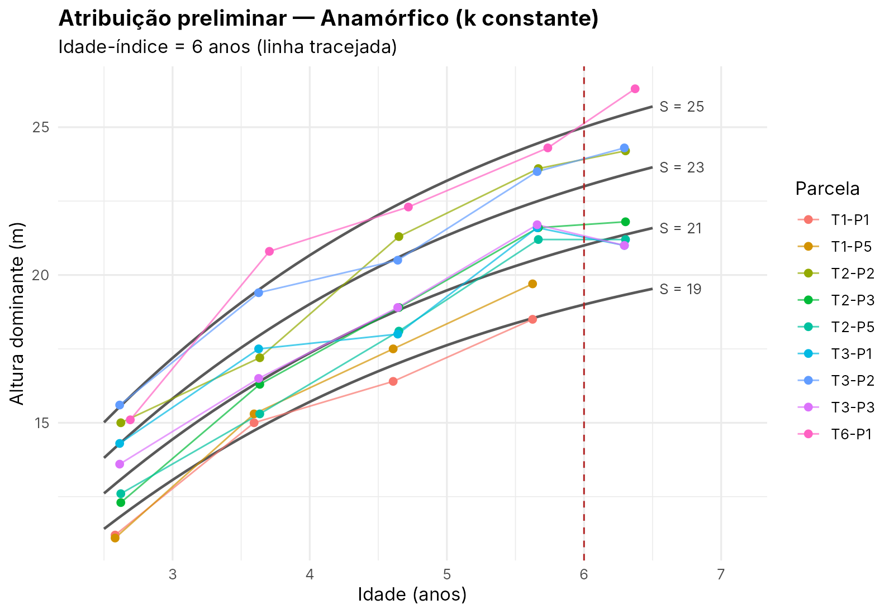
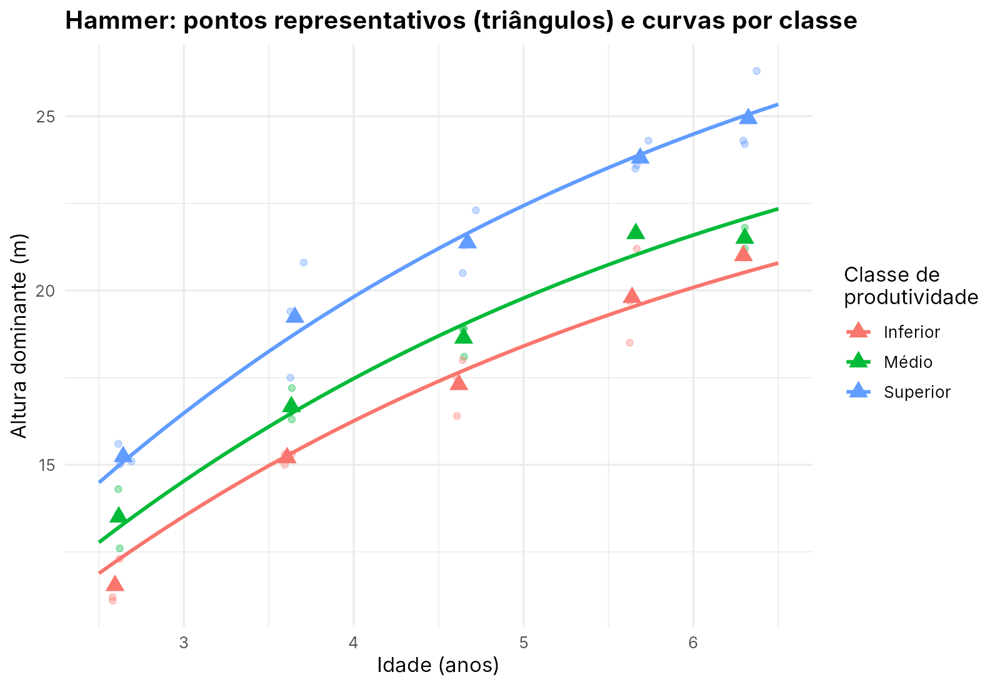
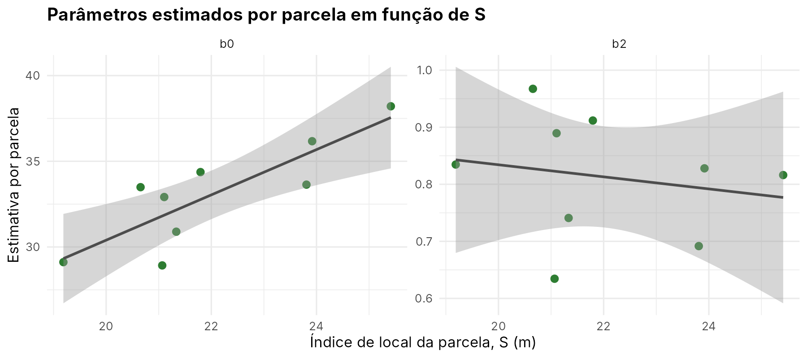
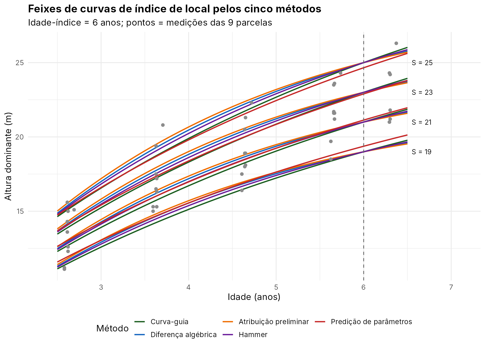

# Relatório — Desafio 07: Classificação da Capacidade Produtiva de Sítio

Mensuração Florestal · PPG em Ciências Florestais · ICA/UFMG · 2026/2

## 1. Dados e definições comuns

A base `Sitio.xls` tem 43 medições de altura dominante (Hd) em 9 parcelas permanentes do projeto C531 (talhões 1, 2, 3 e 6). Cada parcela foi medida de 4 a 5 vezes, de 2,58 a 6,37 anos, com Hd de 11,1 a 26,3 m. As parcelas do talhão 1 foram medidas só até 5,63 anos.

Três observações sobre os dados orientam a análise:

- As medições ocorreram em cinco ocasiões (≈ 2,6; 3,6; 4,6; 5,7 e 6,3 anos), o que facilita a formação de classes de idade no método de Hammer.
- Nas parcelas T3-P1 e T3-P3, a Hd **diminui** entre a 4ª e a 5ª medição (21,6 → 21,0 m e 21,7 → 21,0 m), e na T2-P5 fica estável (21,2 m). Altura dominante não deveria diminuir; a causa provável é erro de medição ou mudança das árvores que compõem a Hd. Esses pontos foram mantidos, mas aumentam o erro de todos os métodos e as trocas de classe.
- O intervalo de idades é curto (≈ 4 anos) e não alcança a fase em que o crescimento em altura estabiliza. Por isso, a assíntota dos modelos é mal determinada.

Definições usadas nos cinco scripts (arquivo `scripts/00_config.R`):

| Definição | Valor adotado | Justificativa |
|---|---|---|
| Modelo de crescimento de base | Chapman-Richards: Hd = b₀ · (1 − e−b₁·I)b₂ | Modelo biológico, com assíntota e ponto de inflexão; o mesmo modelo é usado nas partes 1, 2, 3 e 5 |
| Idade-índice (Ii) | **6 anos** | Dentro da amplitude observada, próxima da idade de corte do eucalipto e da última medição de 8 das 9 parcelas, o que reduz a extrapolação |
| Classes de S | **19, 21, 23 e 25 m** (classes de 18–20, 20–22, 22–24 e 24–26 m) | Cobrem a amplitude de S das 9 parcelas sem desenhar curvas muito fora dos dados |
| Classificação de cada parcela | Medição mais próxima de Ii, projetada para Ii | É a projeção mais curta, logo a de menor erro; a variação de S entre as medições da parcela é registrada como medida de estabilidade |

## 2. Parte 1 — Curva-guia

Foram ajustados três modelos com os 43 pares (Hd, idade) agrupados:

| Modelo | Parâmetros | R² | Syx (m) | Syx (%) | AIC |
|---|:-:|:-:|:-:|:-:|:-:|
| **Chapman-Richards** | 3 | 0,787 | 1,81 | 9,72 | 56,0 |
| Schumacher | 2 | 0,784 | 1,81 | 9,69 | 54,8 |
| Logístico | 3 | 0,786 | 1,82 | 9,75 | 56,3 |

Os três modelos são praticamente equivalentes: a diferença de Syx não passa de 0,06 ponto percentual, e os resíduos têm o mesmo padrão. Foi mantido o **Chapman-Richards** (b₀ = 34,05; b₁ = 0,156; b₂ = 0,846), porque o enunciado exige o mesmo modelo de base nas partes 1, 2, 3 e 5 e a perda em relação ao Schumacher é desprezível (0,03 p.p.). Os erros-padrão dos parâmetros são altos (nenhum é significativo isoladamente), sinal de que três parâmetros são muitos para um intervalo de idade tão curto: b₀, b₁ e b₂ se compensam.

O R² baixo (0,79) é esperado no método: a curva-guia é uma curva média, e a variação **entre** parcelas (que é justamente a diferença de sítio) fica no resíduo.

Pelo método da proporcionalidade, S = Hd · f(Ii) / f(I), em que f é a curva-guia. As curvas são **anamórficas**: todas têm o mesmo formato e a razão entre duas curvas é constante com a idade.

## 3. Parte 2 — Diferença algébrica

A partir do Chapman-Richards, foram derivadas duas equações em diferença, ajustadas a 34 pares **consecutivos** de medições da mesma parcela (combinar todas as medições entre si inflaria artificialmente o número de observações):

- **Anamórfica** (b₀ dependente do sítio): H₂ = H₁ · [(1 − e−b₁·I₂) / (1 − e−b₁·I₁)]b₂
- **Polimórfica** (b₂ dependente do sítio): H₂ = b₀ · (H₁/b₀)ln(1 − e−b₁·I₂) / ln(1 − e−b₁·I₁)

| Formulação | Syx nos pares (m) | Syx (%) | RMSE da projeção a partir de Ii (m) |
|---|:-:|:-:|:-:|
| **Anamórfica** (b₁ = 0,307; b₂ = 1,151) | 1,12 | 5,62 | **0,84** |
| Polimórfica (b₀ = 28,77; b₁ = 0,247) | 1,04 | 5,19 | 1,63 |

A polimórfica ajusta um pouco melhor os pares consecutivos, que são projeções de cerca de um ano. Porém, as curvas de sítio são usadas para projetar de Ii até idades distantes. Ao projetar a medição mais próxima de Ii de cada parcela para as demais idades, o erro da polimórfica dobra (1,63 contra 0,84 m): com assíntota comum de apenas 28,8 m, as curvas dos sítios bons ficam achatadas e as dos sítios ruins caem demais nas idades jovens. Por isso, foi selecionada a **formulação anamórfica**.

**Comparação com a curva-guia:** as duas são anamórficas (a razão entre as curvas de S = 25 e S = 19 é constante, 1,316, nas duas), mas não são idênticas. A diferença algébrica estima o formato da curva a partir do crescimento **dentro** de cada parcela, enquanto a curva-guia mistura parcelas de sítios diferentes. A curva-guia fica abaixo das demais nas idades jovens (figura da seção 7).

## 4. Parte 3 — Atribuição preliminar de índices de local

O S preliminar de cada parcela veio da curva-guia (Parte 1). Com ele como covariável, foi ajustado o modelo:

Hd = S · [(1 − e−k·I) / (1 − e−k·Ii)]b₂, com k = c₀ (anamórfico) ou k = c₀ + c₁·S (polimórfico)

Essa forma garante Hd = S na idade-índice, preservando o significado de S.

| Modelo | R² | Syx (m) | Syx (%) | Teste F para c₁ |
|---|:-:|:-:|:-:|:-:|
| **Anamórfico** (c₀ = 0,350; b₂ = 1,248) | 0,959 | 0,79 | 4,22 | — |
| Polimórfico | 0,959 | 0,79 | 4,26 | p = 0,686 |

O termo c₁ não é significativo: com estes dados, não há evidência de que o formato da curva mude com o sítio. Foi selecionado o modelo **anamórfico**.

O R² sobe de 0,79 (curva-guia) para 0,96 porque S entra como covariável e explica a diferença entre parcelas. Esse ganho é parcialmente circular, já que S foi estimado com os mesmos dados.

**Reclassificação:** com o modelo final, os S mudaram no máximo 0,18 m, e **nenhuma parcela mudou de classe**. A atribuição preliminar pela curva-guia já era consistente.

## 5. Parte 4 — Método de Hammer

As 43 medições foram agrupadas em cinco classes de idade (2,5–3,0; 3,5–4,0; 4,5–5,0; 5,5–6,0 e 6,0–6,5 anos). Em cada classe, as medições foram ordenadas por Hd e divididas em terços (inferior, médio e superior), e a média de cada terço deu a Hd representativa. Foi ajustado um Chapman-Richards com assíntota própria por classe de produtividade e forma comum (b₁ = 0,244; b₂ = 1,007), que deu S de 20,1, 21,6 e 24,5 m para as classes inferior, média e superior. Curvas separadas por classe (9 parâmetros para 15 pontos) reduziram o AIC em menos de 2 unidades e foram descartadas por parcimônia.

Na última classe de idade, faltam as duas parcelas do talhão 1 (medidas só até 5,6 anos), o que muda a composição dos terços. Isso explica por que a Hd média da classe média cai de 21,6 m (5,5–6,0 anos) para 21,5 m (6,0–6,5 anos). Esse é um risco típico do método: como ele não segue as mesmas parcelas no tempo, mudanças na amostra entre idades aparecem como se fossem crescimento.

**Quando Hammer é preferível.** O método só precisa de medições pontuais de Hd em povoamentos de idades diferentes, sem acompanhar as mesmas parcelas. Por isso, é útil:
- quando só há **inventários temporários** (inventário pré-corte ou de cadastro), comuns em empresas sem rede de parcelas permanentes;
- em **espécies ou regiões novas**, em que ainda não existem séries longas, mas há talhões de várias idades;
- para uma **primeira classificação rápida**, a ser refinada depois por diferença algébrica, quando as parcelas permanentes acumularem remedições.

A limitação é que a amostra precisa cobrir sítios semelhantes em todas as idades; se os plantios mais velhos estiverem concentrados em sítios melhores ou piores, as curvas ficam viesadas.

## 6. Parte 5 — Predição de parâmetros

O Chapman-Richards completo (3 parâmetros) ajustado por parcela produziu assíntotas instáveis, de 20,7 a 41,0 m, porque com 4 ou 5 pontos os parâmetros se compensam. Por isso, um parâmetro foi fixado no valor do ajuste conjunto e foram testadas duas alternativas:

| Alternativa | Relações significativas com S | Syx da equação final (%) | Maior desvio de Hd(Ii) em relação a S (m) |
|---|:-:|:-:|:-:|
| A: b₂ fixo, b₀ e b₁ por parcela | nenhuma | 10,60 | 3,94 |
| **B: b₁ fixo, b₀ e b₂ por parcela** | b₀ (p = 0,005; R² = 0,70) | **4,27** | **0,37** |

Na alternativa A, b₀ e b₁ se compensam e nenhum dos dois se relaciona com S; a equação final não reproduz S na idade-índice (desvio de até 3,9 m). Na alternativa B, a assíntota cresce linearmente com S (b₀ = 3,97 + 1,321·S), e b₂ não depende de S (média de 0,813). A equação final é:

Hd = (3,97 + 1,321·S) · (1 − e−0,1556·I)0,813

Como só a assíntota depende de S, as curvas também são **anamórficas**.

## 7. Comparação dos cinco métodos

| Parcela | Curva-guia | Diferença algébrica | Atribuição preliminar | Hammer | Predição de parâmetros | Classe |
|:-:|:-:|:-:|:-:|:-:|:-:|:-:|
| T1-P1 | 19,1 | 19,0 | 19,0 | 19,1 | 18,7 | 19 |
| T1-P5 | 20,4 | 20,2 | 20,2 | 20,3 | 20,1 | 21 |
| T2-P2 | 23,6 | 23,7 | 23,8 | 23,7 | 23,8 | 23 |
| T2-P3 | 21,3 | 21,4 | 21,4 | 21,3 | 21,2 | 21 |
| T2-P5 | 20,7 | 20,8 | 20,8 | 20,8 | 20,5 | 21 |
| T3-P1 | 20,5 | 20,6 | 20,6 | 20,6 | 20,3 | 21 |
| T3-P2 | 23,7 | 23,9 | 23,9 | 23,8 | 24,0 | 23 |
| T3-P3 | 20,5 | 20,6 | 20,6 | 20,6 | 20,3 | 21 |
| T6-P1 | 24,9 | 24,8 | 24,7 | 24,8 | 25,2 | 25 |

*S em metros, na idade-índice de 6 anos.*

**Os cinco métodos classificaram as 9 parcelas na mesma classe**, com diferença máxima de 0,5 m entre métodos para a mesma parcela. Isso acontece porque a classificação usa a medição mais próxima de Ii (no máximo 0,4 ano de distância), trecho em que as curvas de todos os métodos coincidem. As diferenças entre métodos aparecem nas idades jovens, quando se projeta S a partir de medições antigas.

As métricas de ajuste **não são comparáveis entre métodos**: a curva-guia é avaliada nas 43 observações sem informação de sítio; a diferença algébrica, em pares; a atribuição preliminar e a predição de parâmetros usam S estimado com os próprios dados; e Hammer é avaliado em 15 médias, que naturalmente têm menos variância.

## 8. Avaliação das metodologias

| Método | Pontos fortes | Limitações | Uso recomendado |
|---|---|---|---|
| Curva-guia | Simples; precisa só de pares (Hd, idade); funciona com parcelas temporárias | Curvas sempre anamórficas; a curva média depende de como os sítios se distribuem nas idades; R² baixo | Primeira aproximação ou quando só há inventários temporários |
| Diferença algébrica | Usa o crescimento dentro de cada parcela; invariante à idade-índice; permite testar anamorfismo e polimorfismo | Exige parcelas permanentes; pares consecutivos avaliam só projeções curtas | **Método recomendado** quando há remedições, como neste caso |
| Atribuição preliminar | Testa diretamente se S muda o formato da curva | Depende do S preliminar (circularidade); pode exigir iterações | Verificar a forma das curvas e refinar a classificação |
| Hammer | Não precisa de parcelas permanentes | Sensível a mudanças na composição da amostra entre idades; trabalha com médias de poucas parcelas | Talhões de várias idades sem remedição |
| Predição de parâmetros | Representa a variação de sítio por parâmetros com interpretação biológica | Instável com poucas medições por parcela; parâmetros correlacionados exigem fixar um deles | Redes com muitas medições por parcela, ou via modelos de efeitos mistos |

**Conclusão.** Com estes dados, os cinco métodos levam à mesma classificação das parcelas, e todos indicam curvas anamórficas: os testes de polimorfismo (diferença algébrica e atribuição preliminar) não sustentaram curvas de formatos diferentes. Para uso prático, a **diferença algébrica anamórfica** é a mais indicada, porque usa a estrutura longitudinal dos dados, teve o menor erro de projeção a partir da idade-índice (0,84 m) e não depende de um S preliminar.

As principais limitações são o número pequeno de parcelas (9), o intervalo de idade curto (que impede estimar bem a assíntota) e as quedas de Hd em duas parcelas. As curvas não devem ser extrapoladas para além de cerca de 6,5 anos nem para sítios fora da faixa de 18 a 26 m.
